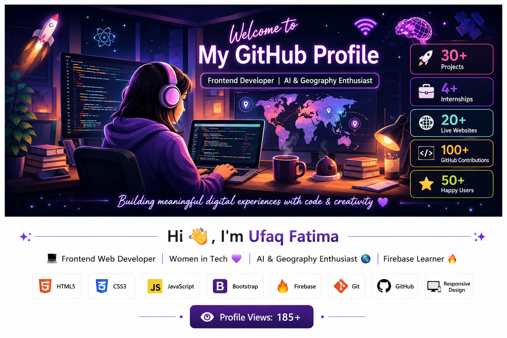

<!-- PROFILE BANNER -->

  

<h1 align="center">Hey there! I'm Ufaq Fatima 👋</h1>

<h3 align="center">
  💻 Frontend Web Developer | 🌍 Geography Graduate | 🐍 Python Enthusiast
</h3>

  
  

  
  
  

---

## ✨ About Me

I'm a passionate **Frontend Web Developer** who enjoys transforming ideas into modern, responsive, and interactive web experiences.

With a background in Geography and a growing passion for technology, I love combining creativity, problem-solving, and development to build meaningful digital solutions.

- 💻 Building responsive and user-friendly websites.
- ⚡ Working with JavaScript, APIs, and modern frontend tools.
- 🗄️ Exploring Supabase, Authentication, and CRUD operations.
- ⚛️ Currently improving my React.js skills.
- 🐍 Exploring Python and programming concepts.
- 🌍 Interested in GIS, mapping, and technology.
- 💜 Passionate about Women in Tech.

---

## 🛠️ Tech Stack & Tools

### Frontend Development

  

### Backend & Database

  

### Programming & Tools

  

### Other Skills

- Responsive Web Design
- API Integration & Axios
- DOM Manipulation
- GSAP Animations
- UI/UX Fundamentals
- GIS Mapping & ArcGIS
- Canva & Microsoft Office

---

## 🚀 Featured Projects

<table>
<tr>
<td width="50%">
<h3 align="center">🏫 CampusConnect</h3>

A student community platform with posts, polls, events, study partners, notifications and an admin dashboard.

<b>HTML | CSS | JavaScript | Supabase</b>

<a href="https://github.com/UfaqFatima786/Campus-Connect-">Repository</a> ·
<a href="https://ufaqfatima786.github.io/Campus-Connect/">Live Demo</a>

</td>
<td width="50%">
<h3 align="center">⚡ QuickServe</h3>

A service marketplace connecting customers with service providers, featuring authentication and service booking workflows.

<b>HTML | CSS | JavaScript | Supabase</b>

<a href="https://github.com/UfaqFatima786/Quick-Serve">Repository</a> ·
<a href="https://quick-serve-hackathon.netlify.app/">Live Demo</a>

</td>
</tr>
<tr>
<td width="50%">
<h3 align="center">👗 Little Princess</h3>

A modern girls' frock e-commerce store with product details, shopping cart and wishlist functionality.

<b>React | JavaScript | CSS</b>

<a href="https://github.com/UfaqFatima786/React-Frok-E-Commerce">Repository</a>

</td>
<td width="50%">
<h3 align="center">🖼️ Soft Gallery</h3>

A React-based image gallery project focused on reusable components and a clean user interface.

<b>React | JavaScript | CSS</b>

<a href="https://github.com/UfaqFatima786/Soft-Gallery">Repository</a>

</td>
</tr>
</table>

  

---

## 💼 Internship Experience

- CodeAlpha
- SyntecxHub
- Codveda Technologies
- CrixSoft
- Decode Labs
- HexSoftwares
- Auspify

Worked on practical frontend development tasks, responsive websites, JavaScript applications, APIs, forms, and interactive interfaces.

---

## 🏆 Achievements & Activities

- 🤖 AI FemHack Hackathon Participant – 2026
- 💻 Multiple frontend development internship projects
- 🚀 Building and deploying personal web development projects
- 💜 Interested in empowering women in technology

---

## 📚 Currently Learning

- React.js & Component-Based Development
- Advanced JavaScript
- API Integration
- Backend Development
- Modern UI/UX
- Python

---

## 📊 GitHub Analytics

  
  

---

## 🔥 Contribution Streak

  

---

## 📈 Contribution Activity

  

---

<h3 align="center">💜 Let's Connect & Build Something Amazing!</h3>

  <i>"Turning ideas into interactive digital experiences, one project at a time."</i>

  ⭐ Thanks for visiting my GitHub profile!

``

Currently focusing on:

* ⚡ Advanced JavaScript
* ⚛️ React.js
* 🔌 API Integration
* 🗄️ Supabase
* 🎨 Modern UI/UX
* 📱 Responsive Web Development
* 🚀 Full-Stack Development

---

# 📊 GitHub Analytics

  

  

----

# 🔥 GitHub Streak

 

  

---

# 📈 GitHub Activity

  

---

# 🌐 Connect With Me

---

<h3 align="center">💜 Thanks for visiting my profile!</h3>

⭐ Feel free to explore my repositories and projects.

